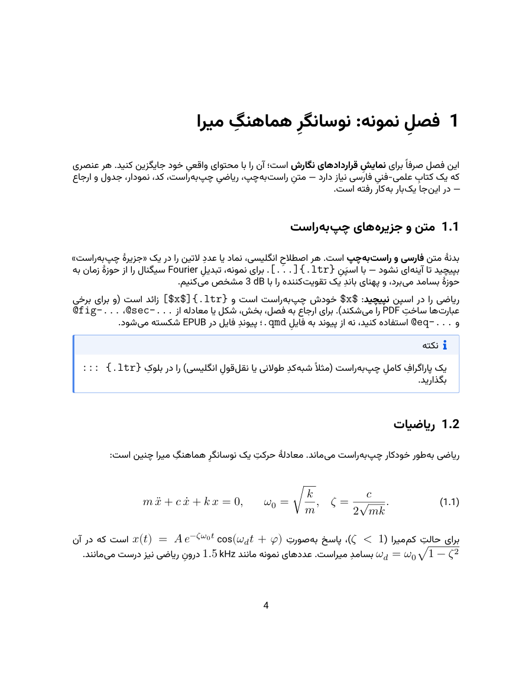
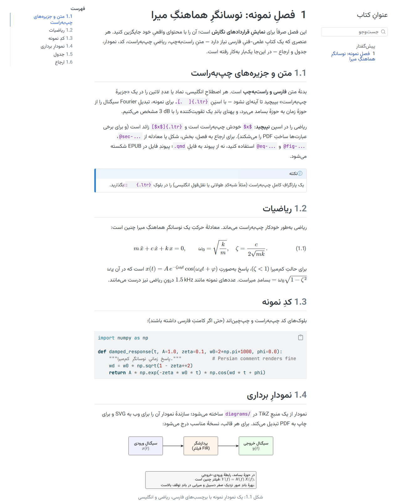

# Expected output · خروجیِ موردِ انتظار

These files are what `python tools/build_all.py` produces for the sample book in this
template, committed so you can see the result before installing anything, and compare
your own first build against it.

این فایل‌ها همان چیزی است که `python tools/build_all.py` برای کتابِ نمونهٔ این قالب می‌سازد؛
در مخزن نگه داشته شده‌اند تا پیش از نصبِ هر چیز نتیجه را ببینید و نخستین ساختِ خودتان را با
آن بسنجید.

| File | What it is | What to look at |
|---|---|---|
| [`sample-book.pdf`](sample-book.pdf) | the print/PDF edition | Persian right-to-left in Vazirmatn; math, code and English left-to-right. **Select a Persian sentence, copy it, paste it into a text editor, and search for «می‌شود»**: the text comes out as you see it |
| [`sample-book.epub`](sample-book.epub) | the EPUB 3 (Apple Books, Google Play Books, Kobo) | right-to-left page turns, MathML equations, vector figure; 0 errors and 0 warnings in epubcheck |
| [`sample-book-kindle.epub`](sample-book-kindle.epub) | the Kindle edition (Amazon KDP) | equations as text or PNG, figure as PNG, wrapping code; open it in Kindle Previewer |
| [`sample-book-kindle-cover.jpg`](sample-book-kindle-cover.jpg) | the Kindle marketing cover | 2560 px high, 300 DPI, sRGB |
| `pdf-page-01.png` … `pdf-page-07.png` | previews of every PDF page | |
| [`website.png`](website.png) | a screenshot of the sample chapter on the website | |

In a build these are `_book/<title>.pdf`, `_book/<title>.epub`, `_book/book-kindle.epub` and
`_book/book-kindle-cover.jpg`; they have ASCII names here.





## Refreshing

`_book/` is git-ignored and a normal build never touches this folder (every render changes
the bytes of a PDF or EPUB). After changing the template itself (`theme/`, `tools/`, the
sample chapter):

```bash
python tools/build_all.py
python tools/update_examples.py
```

**In your own book's repository, delete this folder** (and `tools/update_examples.py` if you
do not want committed outputs).

**در مخزنِ کتابِ خودتان این پوشه را پاک کنید** (و اگر خروجیِ commitشده نمی‌خواهید،
`tools/update_examples.py` را هم).
